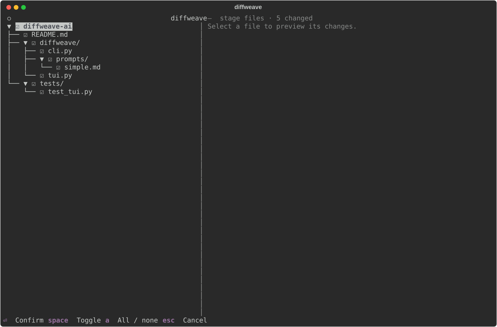
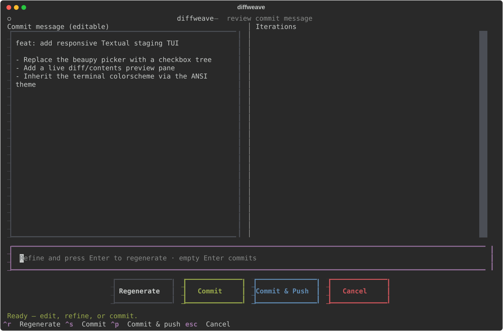
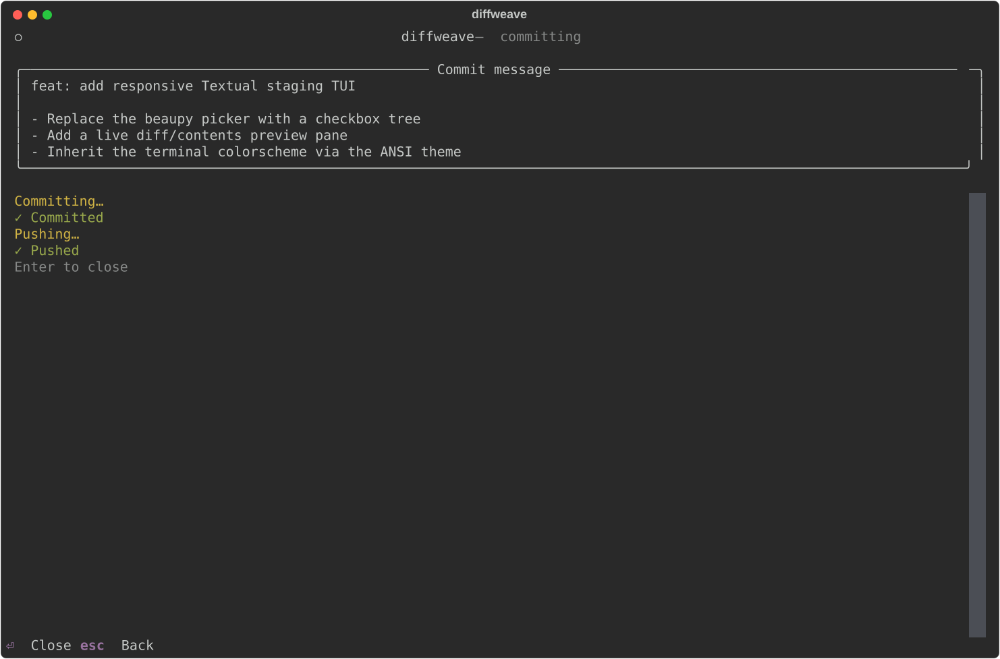

# DiffWeave

DiffWeave is a tool that automatically generates meaningful Git commit messages and pull request descriptions using large language models (LLMs). It analyzes your staged changes and creates descriptive commit messages, saving you time and ensuring consistent documentation.

[Documentation available here](https://block.github.io/diffweave-ai/)

## Screenshots

**Interactive staging** — a checkbox file tree with a live diff/contents preview pane (shown side-by-side on wide terminals, tree-only on narrow ones):



**Commit review** — edit the generated message, refine it with feedback, and regenerate, all in place:



**Commit & push** — the commit and push run live inside the TUI with status updates:



## Installation & Quick Start

You can run DiffWeave via `uvx diffweave-ai` or from a local checkout using `uv run diffweave-ai` while developing this repo.

DiffWeave is installed as an isolated tool using `uv`:

```bash
# Make sure you have uv installed first
# https://docs.astral.sh/uv/getting-started/installation/

uvx diffweave-ai
```

## Usage

### Configure a model

Before generating commit messages, configure your model. DiffWeave supports two authentication types:

**Token-based (OpenAI-compatible endpoints):**

```bash
uvx diffweave-ai set-token-model "your-model-name" \
  --token "$YOUR_API_TOKEN" \
  --endpoint "https://your-endpoint-url"
```

The `--endpoint` flag defaults to `https://api.openai.com/v1` if omitted.

**Databricks (browser-based authentication):**

```bash
uvx diffweave-ai set-databricks-browser-model "your-model-name" \
  --account "your-databricks-account"
```

This opens a browser window for authentication and caches the resulting token automatically.

### Generate a commit message

Once you have a model configured and some changes staged in your current Git repository, run:

```bash
uvx diffweave-ai
```

This will:

- Show the current `git status`.
- Open an interactive staging TUI — a checkbox file tree with a live diff/contents preview pane.
- Generate a commit message using your configured model.
- Open a review TUI where you can edit the message, refine it with feedback, and regenerate.
- Run `git commit` and `git push` live from the review screen.
- Optionally open the repository in a browser (requires `--open-browser`).

If you prefer a simpler, natural-language style instead of Conventional Commits, pass `--simple`:

```bash
uvx diffweave-ai --simple
```

To preview a message without committing:

```bash
uvx diffweave-ai --dry-run
```

For scripted or automated workflows (skips all prompts, commits, and pushes automatically):

```bash
uvx diffweave-ai --non-interactive
```

### Generate a pull request description

To generate a PR title and body based on the diff between your branch and `main`:

```bash
uvx diffweave-ai pr
```

The result is copied to your clipboard automatically. Use `--branch` to diff against a branch other than `main`:

```bash
uvx diffweave-ai pr --branch my-base-branch
```

## Features

- AI-powered commit message generation based on staged diffs
- Interactive staging TUI with a checkbox file tree and live diff/contents preview
- In-place commit-review TUI: edit, refine with feedback, regenerate, commit, and push
- Pull request description generation with automatic clipboard copy
- Interactive or non-interactive workflows
- Token-based (OpenAI-compatible) and Databricks browser authentication
- Optional simpler commit style via `--simple`
- Optional push and browser-open flow after committing
