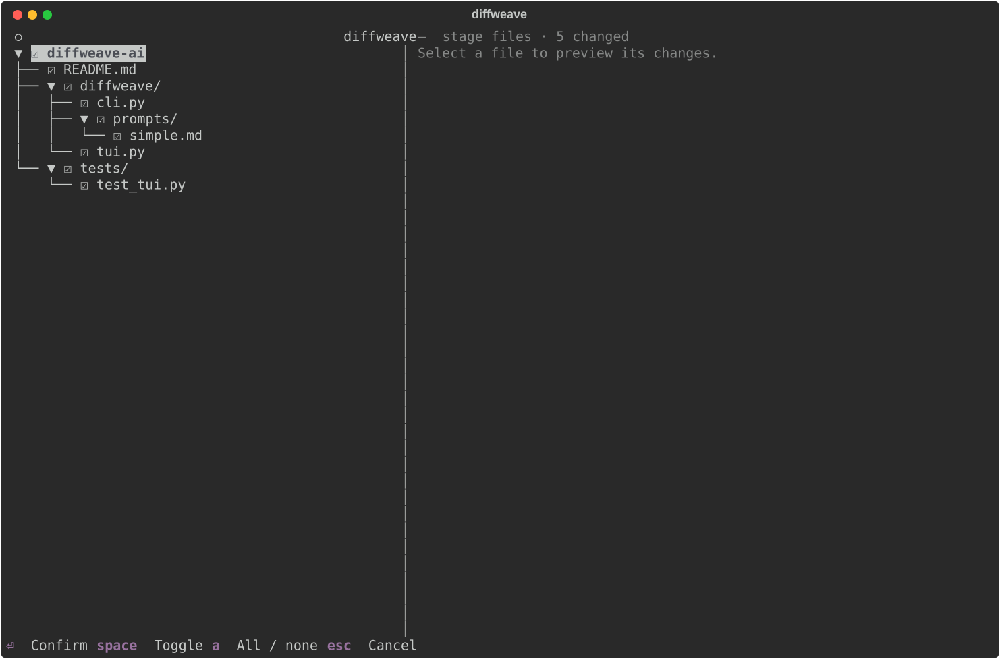
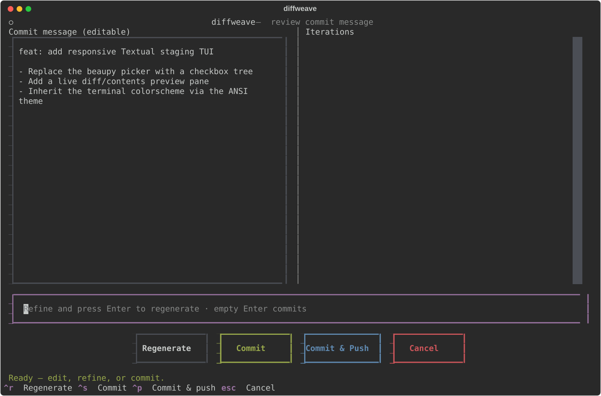
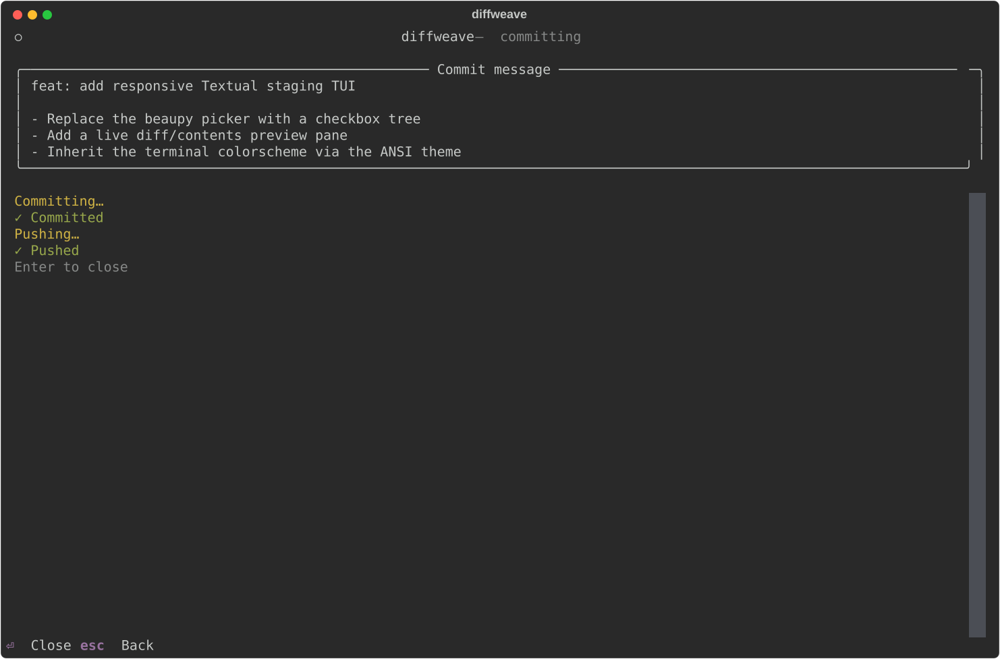

# DiffWeave

DiffWeave is a tool for automatically generating commit messages and pull request descriptions using large language models (LLMs).
The goal is for this tool to be intuitive to use and to help you write meaningful commit messages.

## Screenshots

**Interactive staging** — a checkbox file tree with a live diff/contents preview pane (shown side-by-side on wide terminals, tree-only on narrow ones):



**Commit review** — edit the generated message, refine it with feedback, and regenerate, all in place:



**Commit & push** — the commit and push run live inside the TUI with status updates:



For details on setting up models and the configuration file, see the
[Getting Started](installation.md) page.

## CLI Reference

The `diffweave-ai` CLI is exposed as a uv tool. You will most commonly invoke it as:

```bash
uvx diffweave-ai [OPTIONS]
```

From a local checkout of this repository, you can also run it via:

```bash
uv run diffweave-ai [OPTIONS]
```

### Default command — commit

Running `diffweave-ai` with no subcommand starts the interactive commit flow:

- Shows the current git status.
- Opens an interactive staging TUI — a checkbox file tree with a live diff/contents preview pane.
- Generates a commit message using your configured model.
- Opens a review TUI to edit, refine with feedback, and regenerate the message.
- Runs `git commit` and `git push` live from the review screen.
- Optionally opens the repo in your browser if `--open-browser` is set.

Flags:

| Flag | Short | Description |
|------|-------|-------------|
| `--simple` | `-s` | Use natural-language style instead of Conventional Commits (`feat:`, `fix:`, etc.) |
| `--dry-run` | | Generate a commit message and print it, but do not commit or push |
| `--non-interactive` | | Skip all prompts: use the first generated message and push automatically |
| `--verbose` | `-v` | Print the prompt sent to the model before each generation attempt |
| `--open-browser` | `-w` | Open the repository URL in a browser after pushing |

### Subcommands

#### `pr` — Generate a pull request description

Diffs the current branch against a base branch, generates a PR title and body, and copies the result to your clipboard.

```bash
uvx diffweave-ai pr [--branch BRANCH] [-v]
```

| Flag | Default | Description |
|------|---------|-------------|
| `--branch` | `main` | Base branch to diff the current branch against |
| `--verbose, -v` | | Print the prompt sent to the model |

#### `set-token-model` — Configure a token-authenticated model

Configures a token-authenticated OpenAI-compatible model as the active LLM. Overwrites any existing configuration.

```bash
uvx diffweave-ai set-token-model MODEL_NAME --token TOKEN [--endpoint URL]
```

| Flag | Short | Default | Description |
|------|-------|---------|-------------|
| `MODEL_NAME` | `-m` | *(required)* | Model identifier (e.g. `gpt-4o`, `claude-3-5-sonnet-20241022`) |
| `--token` | `-t` | *(required)* | API token for the endpoint |
| `--endpoint` | `-e` | `https://api.openai.com/v1` | Base URL of the OpenAI-compatible API endpoint |

#### `set-databricks-browser-model` — Configure a Databricks model

Configures a Databricks-hosted model as the active LLM using browser-based authentication. Overwrites any existing configuration.

```bash
uvx diffweave-ai set-databricks-browser-model MODEL_NAME --account ACCOUNT
```

| Flag | Short | Description |
|------|-------|-------------|
| `MODEL_NAME` | `-m` | Model identifier as it appears in Databricks serving endpoints |
| `--account` | `-a` | Databricks workspace account name (e.g. `my-org`) |

You can always view up-to-date help by running:

```bash
uvx diffweave-ai --help
uvx diffweave-ai pr --help
uvx diffweave-ai set-token-model --help
uvx diffweave-ai set-databricks-browser-model --help
```
